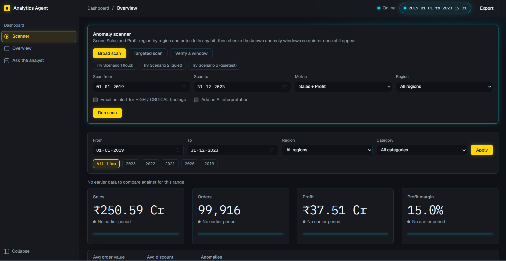
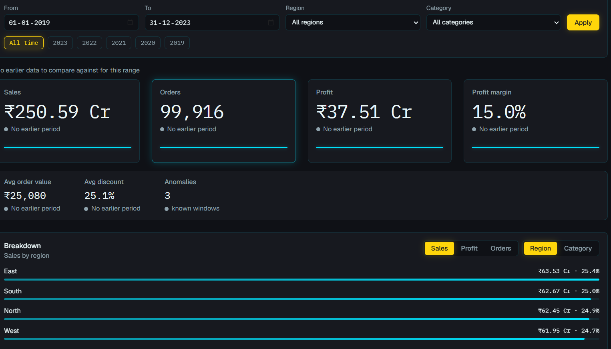
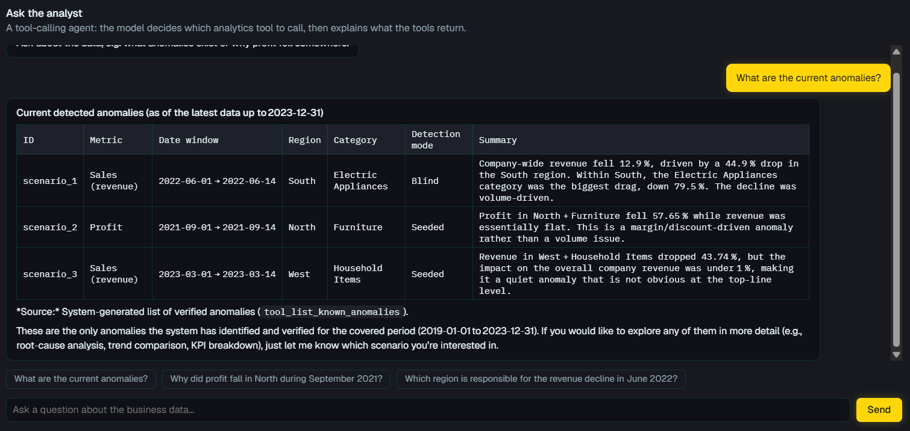
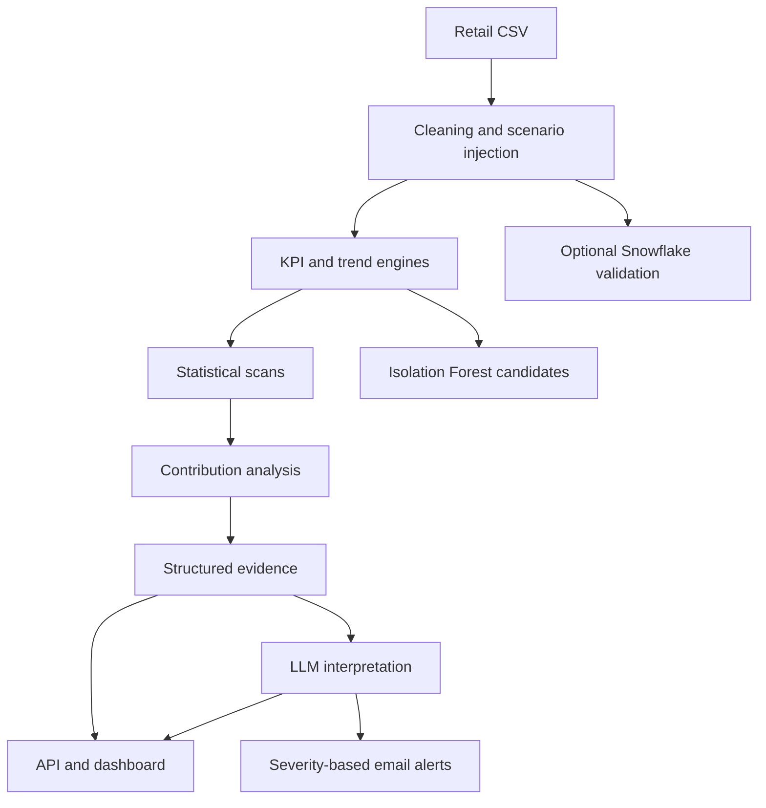

# AI-Powered Business Analytics & Anomaly Detection Agent

**Spot unusual retail performance, trace the contributing segments, and explain the evidence in plain language.**


[Demo](https://ai-business-analytics-agent-h2by.onrender.com) · [Source repository](https://github.com/LuffyXoro/AI_ANALYTIC_AGENT) · [Demo API docs](https://ai-business-analytics-agent-h2by.onrender.com/docs)



The system follows a **statistics-first, LLM-second** workflow: analytical engines calculate metrics and detect unusual movements, a contribution engine builds an evidence chain, and an LLM interprets the resulting evidence. A FastAPI dashboard brings scanning, KPI exploration, and natural-language questions into one interface.

## Key Features

- **Seven business KPIs:** revenue, orders, units sold, average order value, profit, profit margin, and average discount rate, with SQL/Python cross-checks reported.
- **Flexible anomaly investigation:** broad regional scans, targeted region/category scans, and verification of an exact date window.
- **Statistical and ML detection:** period-average significance testing plus Isolation Forest candidates based on weekly rolling-baseline ratios.
- **Contribution-based explanations:** drill into the segments driving a change and distinguish volume, price, and margin effects.
- **Evidence-grounded AI:** structured evidence supports interpretation and tool-calling Q&A; prompts require facts and hypotheses to remain separate.
- **Interactive dashboard:** date, region, and category filters; KPI cards; sparklines; breakdowns; and CSV export.
- **Email notifications:** HIGH and CRITICAL impact alerts with a documented 24-hour cooldown per anomaly scope. See the alerting limitation below.
- **Optional warehouse and automation:** Snowflake validation, Render deployment configuration, and a scheduled GitHub Actions pipeline.

## Visuals & Demo

Open the [hosted dashboard](https://ai-business-analytics-agent-h2by.onrender.com) to explore **Scanner**, **Overview**, and **Ask the analyst**. The project report describes a delay on the first request after the service has been idle; current availability has not been checked.

### Dashboard overview

The overview above shows sales, orders, profit, profit margin, average order value, and average discount, alongside date, region, and category filters. The screenshot covers 2019–2023 and displays **99,916 orders**. The “3 known windows” count refers to injected scenarios, not three independently detected, statistically significant events.

### Anomaly scanner

Choose **Broad scan**, **Targeted scan**, or **Verify a window**, then select the date range, metric, and scope. The interface includes scenario shortcuts and optional email and AI interpretation controls.



The interface describes a regional scan followed by checks of known anomaly windows. Findings from those known-window checks should be distinguished from blind discoveries. This screenshot shows the scan controls, not a completed detection result.

### Ask the analyst

Ask a business question and inspect the response returned through the analytics tools. This example asks, **“What are the current anomalies?”**, and displays the known scenario windows, affected segments, and summaries.



> Screenshot clarification: the captured response uses “detected” and “verified” broadly. Its source is `tool_list_known_anomalies`, a list of known injected scenarios. Scenario 3 is **not statistically significant** under the documented single-metric test (z = −1.55). Listing a scenario is not proof of independent detection or statistical significance.

<!-- Optional future visual: add a recording or screenshot of a completed Scenario 1 scan showing significance, severity, and the contribution breakdown. -->

### Architecture



Isolation Forest provides ranked investigation candidates; its output is not an automatic email trigger.

## Prerequisites & Installation

### Prerequisites

- Git and Python with `pip` and `venv`. The report records **Python 3.11.9** for deployment; it does not specify a supported version range.
- The project's retail CSV data, either already processed or available for rebuilding.
- A Groq API key for the documented AI/Q&A setup.
- Gmail sender credentials and a recipient if enabling email alerts.
- A Snowflake account only if using the warehouse scripts; the web application reads CSV data directly.

### 1. Clone the repository

```bash
git clone https://github.com/LuffyXoro/AI_ANALYTIC_AGENT.git
cd AI_ANALYTIC_AGENT
```

### 2. Create and activate a virtual environment

**Windows PowerShell**

```powershell
python -m venv .venv
.\.venv\Scripts\Activate.ps1
```

**macOS / Linux**

```bash
python3 -m venv .venv
source .venv/bin/activate
```

### 3. Install dependencies

```bash
python -m pip install -r requirements.txt
```

### 4. Configure the environment

**Windows PowerShell**

```powershell
Copy-Item .env.example .env
```

**macOS / Linux**

```bash
cp .env.example .env
```

Edit `.env` using the configuration table below. Do not commit credentials.

### 5. Prepare the data if needed

If the processed data is unavailable, obtain the **Indian Store Data** dataset referenced in the project and check the ingestion script for its expected input location before running:

```bash
python src/ingestion/clean_data.py
python src/ingestion/inject_anomalies.py
```

The supplied documents do not identify the exact dataset download URL or raw CSV filename/path. These must be confirmed in the repository before rebuilding the data.

### 6. Start the application

```bash
python -m uvicorn src.api.main:app --reload --port 8000
```

- Dashboard: [http://localhost:8000/](http://localhost:8000/)
- Interactive API docs: [http://localhost:8000/docs](http://localhost:8000/docs)

## Usage Examples

### Check service health

```bash
curl http://localhost:8000/health
```

### Verify the documented North / Furniture profit anomaly

**Bash**

```bash
curl -X POST http://localhost:8000/check-window \
  -H 'Content-Type: application/json' \
  -d '{"window_start":"2021-09-01","window_end":"2021-09-14","region":"North","category":"Furniture","metric":"profit"}'
```

**PowerShell**

```powershell
$body = @{
    window_start = "2021-09-01"
    window_end   = "2021-09-14"
    region       = "North"
    category     = "Furniture"
    metric       = "profit"
} | ConvertTo-Json

Invoke-RestMethod -Method Post `
    -Uri "http://localhost:8000/check-window" `
    -ContentType "application/json" `
    -Body $body
```

The report records approximately `z_score = -2.36`, `is_significant = true`, a profit change of `-57.65%`, and CRITICAL impact severity for this scenario. These are reference values, not a complete response schema. Use `/docs` to inspect request defaults, including alert options, before execution.

### Run the pipeline without email alerts

```bash
python src/run_pipeline.py --no-alert
```

### Run the documented test suite

```bash
python -m pytest tests/ -v
```

### Explore the API

| Method | Endpoint | Purpose |
|---|---|---|
| GET | `/health` | Health check |
| GET | `/` | Dashboard |
| GET | `/kpis` | KPIs with date and optional segment filters |
| GET | `/trends` | Period-over-period metric comparisons |
| GET | `/anomalies`, `/anomalies/{id}` | Documented scenarios |
| GET | `/root-cause/{id}` | Scenario evidence and impact |
| POST | `/scan` | Broad or targeted scan |
| POST | `/check-window` | Exact-window verification |
| POST | `/ask` | Natural-language analytical questions |
| POST | `/run-analysis` | Run the analysis pipeline |
| POST | `/send-alert` | Trigger an alert |

The documents also list `/timeseries` as optional. Check the running application's `/docs` for available routes and their exact schemas.

## Configuration / Environment Variables

Use the repository's `.env.example` as the authoritative template.

| Variable | Purpose | When needed |
|---|---|---|
| `LLM_PROVIDER` | Interpretation provider: documented values are `groq` (default) and `gemini` | AI interpretation |
| `GROQ_API_KEY` | Groq authentication | Groq interpretation and the documented Q&A agent |
| `ALERT_EMAIL_FROM` | Sender email address | Email alerts |
| `ALERT_EMAIL_APP_PASSWORD` | Gmail app password | Email alerts |
| `ALERT_EMAIL_TO` | Recipient email address | Email alerts |
| `SNOWFLAKE_*` | Warehouse connection settings; this denotes a family of variables, not a literal key | Optional warehouse scripts |

Gemini interpretation support is documented, but its credential variable name is not supplied. Check `.env.example` and the provider implementation rather than guessing. Gemini support for the Q&A agent is not established by the provided files.

Deployment is documented through `render.yaml` and `requirements-render.txt`. The scheduled workflow is `.github/workflows/daily_pipeline.yml`, reported to run daily at **06:00 UTC** and support manual dispatch. Configure deployment and workflow secrets outside source control.

## Dataset & Reported Results

The source dataset contains **100,000 retail transactions from 2019–2023** across four regions, ten states, and six categories. The project describes it as synthetic and uses three seeded, explicitly injected anomaly scenarios (`seed=42`). After injection, the dataset contains **99,916 rows**.

| Scenario | Scope and window | Reported outcome |
|---|---|---|
| S1: volume drop | South / Electric Appliances, June 1–14, 2022 | Broad scan found the window; z = −5.16; company sales −12.9% |
| S2: margin squeeze | North / Furniture, September 1–14, 2021 | Exact-window verification: z = −2.36; profit −57.65% with unchanged revenue |
| S3: discount squeeze and order removal | West / Household Items, March 1–14, 2023 | z = −1.55; not statistically significant under the single-metric test |

The report records **29 passing analytical tests** at its last full run and agreement across all seven KPIs between Snowflake and local calculations. These historical results are not a current build guarantee. Reported percentage changes depend on the comparison baseline.

### Known limitations

- **Synthetic evaluation:** results on injected scenarios do not establish performance on organic business anomalies or seasonal data.
- **Quiet anomalies:** broad scanning finds the region-visible S1 event but does not discover S2 or S3 blindly. Exact-window verification requires a suspected scope and period; S3 remains statistically insignificant under that test.
- **ML precision:** the report gives Isolation Forest precision of roughly 5–10% and recall of 3/9 anomaly weeks. Treat detections as candidates for investigation.
- **Small samples and causal uncertainty:** some drilled segments contain fewer than 30 orders. Contribution analysis locates associated changes; it does not prove an external business cause. The report also records an unsupported causal inference in an LLM explanation despite correctly cited numbers.
- **Open alerting defect:** `/check-window` can send a severity-based email for a statistically insignificant result when alerts are enabled. Significance gating is a documented recommendation, not a completed fix.
- **Cooldown persistence:** the report states that hosted cooldown state can be lost across restarts. The scheduled workflow separately commits its cooldown state back to the repository.

## Contributing Guidelines

Bug reports, documentation improvements, and focused pull requests are welcome.

1. Open an issue describing the problem or proposed change. For analytical bugs, include the affected metric, scope, dates, and expected behavior.
2. Fork the repository and create a descriptive branch.
3. Make a focused change; include appropriate tests when changing calculations, detection, or alert behavior.
4. Run `python -m pytest tests/ -v` and describe validation results in the pull request.
5. Update relevant documentation and keep API keys, `.env` files, and private data out of commits.

These are suggested contribution steps; no existing contribution policy was supplied for review.

## License & Acknowledgements

**License:** unspecified in the supplied files. Confirm the repository's license before reuse or redistribution.

Acknowledgements:

- Kaggle's **Indian Store Data**, the dataset named in the project report. An exact dataset URL and its usage terms were not provided.
- Liu, Ting, and Zhou (2008), *Isolation Forest*, for the detection method.
- The open-source Python ecosystem used by the project, including FastAPI, pandas, NumPy, SciPy, scikit-learn, and DuckDB.
- Groq, Gemini, Snowflake, Render, and GitHub Actions for the integrations documented in the project.
